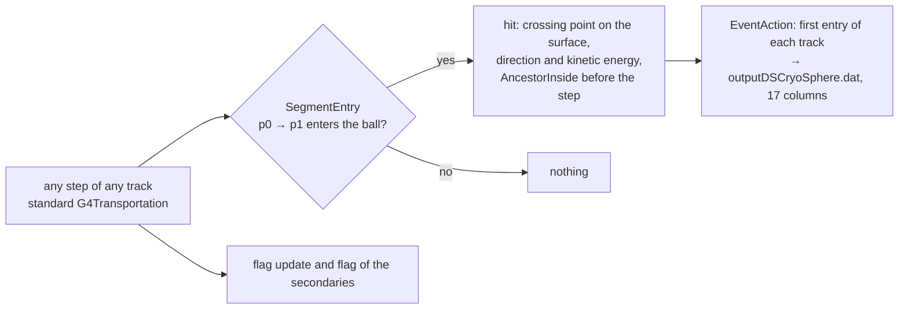

# S1GDML_DM1.2_MultiVerse

Test bed of **Track G** of MAGI (the Track G note of the MAGI development repository, design review in
`docs/TrackG_design_review.md` there): a tracking surface for MAGI that may cut volumes of the mass model,
and a first-entry rule that makes the recorded sample independent of what lies inside it.

This folder is a copy of `S1GDML_DM1.2` (branch `HENABICS-primary-truth`) with the changes listed here.
Branch of the Geant4 repository: `trackG-multiverse`. Only the sources, the GDML geometry, the GPS macros and the
documents were copied; the run and build directories of `S1GDML_DM1.2` were not.
Geant4 10.4.3, sequential build, installed in `<geant4-install>`.

## 1. The idea

In `S1GDML_DM1.2` the tracking surface is a thin `G4Sphere` shell (94.9–95 mm) **placed in the mass world** with a
sensitive detector attached. Wherever such a shell cuts another volume the geometry is invalid, which is why its
radius had to be reduced to 95 mm, and on the Athena mass model no position and radius avoid all the volumes.

**MultiVerse makes the surface virtual.** The ball (centre, radius) is not a Geant4 volume. `SteppingAction` tests every
step: if the straight segment from the pre-step to the post-step point enters the ball, the track has crossed the
surface and its state is recorded. The ball can therefore cut any volume without an overlap, and it changes nothing in
the transport of the mass world (§6 shows that this is exact, and why the obvious alternative is not).



## 2. The first-entry flag

Each track carries `AncestryInfo::AncestorInside`: *this track, or one of its ancestors, has been inside the ball earlier
in its history*. A track that enters the ball with the flag cleared is a **first entry**: its whole history, and that of
every ancestor, lies outside the ball, so it cannot depend on the interior. Those are the particles MAGI learns from.
Everything with the flag set (the albedo of the interior, the daughters of particles born inside, re-entries) is produced
again by the application run from the injected first entries.

| Where | Rule |
|---|---|
| `TrackingAction::PreUserTrackingAction` | a primary is flagged if its vertex lies inside the ball |
| `SteppingAction`, the entry | the hit stores the flag **before** the step, then the step updates it |
| `SteppingAction`, the track | flagged if the step enters the ball or ends inside it |
| `SteppingAction`, the secondaries | a secondary takes the parent's flag **at its creation** (below) and is born flagged if it is created inside |

The secondaries are marked in the stepping action and not in the tracking action, because the flag of the parent is the
right one only in the step in which the secondary is created; a `PostUserTrackingAction` would use the parent's *final*
flag, and a secondary created outside would be flagged because its parent entered later. A secondary produced by a
discrete process sits at the post-step point and takes the parent's flag after the step; one produced along the step
by a continuous process (a delta ray) sits before it and takes the flag from before the step.

"Inside" means closer to the centre than `R − 1 nm`, so a point on the surface is not inside.

## 3. Accuracy of the crossing state

The crossing point is the exact intersection of the straight segment of the step with the sphere (ray–sphere, with the
smaller root for the entry). The direction and the kinetic energy are those of the **pre-step point**: a step is a straight
segment in the transport, and the direction and energy change only at its end. In a step that is long compared with the
distance to the surface, the energy lost between the pre-step point and the surface, and the multiple-scattering deflection
of that part of the step, are neglected. This is the same convention as the original shell (`EPreStep`), so the two agree
exactly (§5), and it is a limit to quantify wherever the ball cuts dense material (G3): there the steps are short.

## 4. Files

### New
| File | Role |
|---|---|
| `include/MultiVerseBall.hh`, `src/MultiVerseBall.cc` | geometry of the ball (radius, centre, `IsInside`), the macro commands `/MultiVerse/radius` and `/MultiVerse/centre`, `SegmentEntry` (ray–sphere), and the list of entries of the current event |
| `include/AncestryInfo.hh` | `G4VUserTrackInformation` with the flag |
| `include/TrackingAction.hh`, `src/TrackingAction.cc` | flag of the primaries |
| `include/LegacyShellSD.hh`, `src/LegacyShellSD.cc` | **diagnostic**: re-creates the original shell and its recording rule (environment `MULTIVERSE_LEGACY_SHELL`), output `outputLegacyShell.dat` |
| `include/MultiVerseWorld.hh`, `src/MultiVerseWorld.cc`, `include/MultiVerseSD.hh`, `src/MultiVerseSD.cc` | **not used by default**: the parallel-world version of the ball, kept as the record of the experiment of §6 (environment `MULTIVERSE_PARALLEL`) |
| `run_multiverse.sh` | one run: `./run_multiverse.sh <mu|gamma> <N> <tag> [radius_mm=95] [seed]`, output in `multiverse_run/<tag>/` |
| `multiverse_run/analyze_g1.py`, `compare_legacy.py`, `run_old_binary.sh`, `analyze_g2.py` | the checks of §5 |
| `g0_surface_scan.cc`, `multiverse_run/run_g0.sh`, `g0_flux.py` | G0: area and flux fraction of a candidate sphere in each volume and material |

### Modified
| File | Change |
|---|---|
| `src/SteppingAction.cc`, `include/SteppingAction.hh` | was an empty stub; now detects the entries, maintains the flag and gives it to the secondaries |
| `src/GDMLDetectorConstruction.cc`, `include/GDMLDetectorConstruction.hh` | the `G4Sphere` shell (`DSCryoSphere`, `physCryoSphere`, `logicCryoSphere`, and its place as root of the `IntermediateRegion`) and `DummySD` are **removed**; they come back only in the legacy-shell diagnostic; the parallel world is registered only with `MULTIVERSE_PARALLEL` |
| `src/PhysicsList.cc`, `include/PhysicsList.hh` | `G4ParallelWorldPhysics` is built only with `MULTIVERSE_PARALLEL` (and then its `ConstructProcess()` is called explicitly, §6) |
| `athena.cc` | registers `TrackingAction` and calls `MultiVerseBall::CreateMessenger()` |
| `src/EventAction.cc`, `include/EventAction.hh` | reads the entries from `MultiVerseBall`, clears them at the start of each event, reads the centre from `MultiVerseBall::Centre()` (it was hard-coded), keeps the "direction points to the centre" test only as a **check** (`fNOutwardEntries`, must stay 0) and writes a **17th column `AncestorInside`** |
| `include/DummyHit.hh` | `AncInside` with `SetAncestorInside` / `GetAncestorInside` |
| `gps*.mac` | the paths of the `MacroGPS*` spectra point to this folder |

### Unchanged
`ACDSD`, `ACDHit`, `DummySD` (no longer instantiated), `PrimaryGeneratorAction`, `PrimaryTruthInfo`, `RunAction`, the GDML
geometry, the physics constructors, `CMakeLists.txt` (it globs `src/*.cc`).

## 5. Output and verification (G1)

`outputDSCryoSphere.dat`, tab separated, one row per first inward hit of each track, as in `S1GDML_DM1.2`, with a 17th column:

```
EventKey ParticleName E[MeV] isPrimary TrackId ParentId CreatorProcess  X Y Z [mm]  Vx Vy Vz
PrimaryTrackId PrimaryPDG PrimaryEnergy[MeV]  AncestorInside      (0 = first entry)
```
All rows are written; the rows with `AncestorInside = 0` are the first-entry sample and the complete set is the sample of the
original project, so one run gives both.

Measured on 4 × 250 000 isotropic muons (`GPS gpsMu_iso.mac`, seeds 3100 + 37 j), R = 95 mm, centre (0, 0, 5) mm:

| Check | Result |
|---|---|
| Rate per primary, MultiVerse (plain transport) / original binary on the same seeds | 0.00485 / 0.00484 |
| γ, `eIoni` γ (8 keV copper fluorescence), e⁻, `eIoni` e⁻ per primary (×10⁻⁴) | 18.5, 2.39, 6.33, 4.49 against 18.4, 2.39, 6.32, 4.48 |
| Tracks recorded by the original shell and not by the ball (same run, `compare_legacy.py`) | **0** of 4 838 |
| Tracks recorded by the ball and not by the shell | 8 (the shell is 0.1 mm thick; 3 primary muons, 4 bremsstrahlung γ, 1 e⁻) |
| Radius of the entry point | within 7.4 × 10⁻⁵ mm of R (floating-point of the intersection) |
| Kinetic energy ball against shell | identical (same convention, §3) |
| Direction ball against shell | 1 − cos = 10⁻⁹ median, 1.2 × 10⁻² maximum |
| Distance between the ball's crossing point and the shell's record | median 0.14 mm, 99 % at 0.93 mm, maximum 2.8 mm (the shell records the inner face, 0.1 mm of radius deeper, which is 0.1 mm / cos θ along the track; the largest values are grazing tracks) |
| Rows with `AncestorInside = 1` | 1.2 %; no primary is flagged |
| Run time | unchanged within the noise (no extra navigation) |

### G2: the first-entry rows against the complete set (R = 95 mm)

4 × 10⁶ muons and 4 × 10⁶ photons (`multiverse_run/analyze_g2.py`, output `G2_analysis.txt`; the runs take about 10 minutes
per 10⁶ muons on one core). The flagged rows are 1.1 % of the crossings of the muon primaries and 0.26 % of those of the
photon primaries, low in energy (3.5 % of the rows below 0.1 MeV, none above 100 MeV) and made by electrons
(bremsstrahlung and ionisation); they are separated from the first entries by a classifier with AUC 0.92 (muons) and 0.79
(photons, 31 rows) against permutation nulls of 0.51 and 0.47, through the energy and the z components of position and
direction. They are the returning albedo of the interior, and the rows with flag 0 are everything else.

### G0: how much of a candidate sphere lies in material (DM1.2)

`g0_surface_scan` (second executable of the CMake; `multiverse_run/run_g0.sh`, `g0_flux.py`) samples the surface of a sphere with random
points and locates each with a `G4Navigator` on the mass geometry as built by the simulation (no physics). Area fraction in material, 4 × 10⁵ points
per radius: 9.4 % (R = 30 mm), 21 % (50), 0.8 % (70), 1.0 % (85), **0 (95)**, 2.4 % (105), 2.1 % (120), 1.7 % (150), 3.1 % (200), 4.2 % (300 mm). The volumes
are passive (copper, nickel, aluminium); the only sensitive volume reached is `PV_DM127` by a sphere of 20 mm. With 4 × 2.5 × 10⁵ muons the crossings
of the spheres of 105 and 120 mm that occur inside the copper plate `Plate_Cu_1` are 6.9 % and 5.5 % of all crossings (area 2.4 % and 2.1 %).
`g0_surface_scan <gdml> points <file>` locates a list of positions (the crossings of a run).

### G3: pipeline, controls and observables

| Script | Role |
|---|---|
| `multiverse_run/run_g3_campaign.sh <R...>` | the full simulation at each radius: 72 M muons and 90 M photons in 8 jobs per species (the halves jobs 0–3 and 4–7 give the statistical baseline) |
| `multiverse_run/run_g3_pipeline.sh <R...>` | per radius: merge the jobs; reinject the first entries of the full runs (the control without a model); train MAGI on the first entries (`--first-entry`, atom, zone table by primary, prior refit); generate and inject the MAGI groups; `analyze_g3.py` |
| `tools/make_reinjection_gntbin.py` (MAGI repository) | crossings of a full run to GNTBIN v2 files for the injector, first entries only or all crossings |
| `run_inject.sh <part.gntbin> <tag> <R>` | application run: inject a GNTBIN file into the full mass model with the ball at the same radius |
| `multiverse_run/analyze_g3.py <R>`, `analyze_interior.py` | the observables below |

Observables, in the order of their sensitivity to the first-entry rule:
1. **Returning entries** (`AncestorInside = 1`) per primary in the application run, against the full run. The injected tracks are
   recorded again as entries by the same ball (flag 0), so the flag-1 rows of an injected run are exactly the albedo regenerated by
   the transport of the injected particles. If the rule is exact the rate equals that of the full run. This is the decisive test
   (pilot at R = 105 mm, 4 × 10⁶ muons: 465 against 517 returning entries, ratio 0.90 ± 0.06).
2. **Interior deposit**: the energy deposited by steps with the midpoint inside the ball, per primary and by volume
   (`outputInterior.dat`). Additive metric; the returning particles carry 0.044 keV per primary against 12.4 keV of deposit, so it
   is sensitive to the rule at the level of 0.4 % at most.
3. **Detector level** (`outputGDML.dat`): the closure of DM1.2, with the ±5 % of its few hundred triggering primaries.

Two plumbing facts found by the pilots: positions that pass through a file (text with six digits, GNTBIN float32) lie on the sphere to
about 10⁻³ mm, so the surface fuzz is 5 µm (`MultiVerseBall::SurfaceTolerance`); with the first tolerance of 1 nm half of the injected
tracks counted as born inside and were flagged. And the all-crossings injection is not a sensitive positive control: the flagged rows
are 2 % of the crossings.

## 6. Why not a parallel world (the experiment that came first)

The first implementation put the ball in a Geant4 **parallel world** (`G4VUserParallelWorld`, `G4ParallelWorldPhysics`), so that the
process would end a step exactly on the surface. It recorded perfect entries (radius within 7 × 10⁻⁵ mm, all inward) and it is still
in the source behind `MULTIVERSE_PARALLEL`. It was abandoned because **it changes the physics of the mass world**:

| Per primary (×10⁻⁴), 4 × 250 000 muons | original binary | parallel-world ball |
|---|---|---|
| all crossings | 48.4 | 43.0 |
| γ | 18.4 | 13.0 |
| `eIoni` γ | 2.39 | 0.25 |
| `eIoni` e⁻ | 4.48 | 0.39 |

The cause is a single line of the log, `G4PhysicsListHelper::AddTransportation()--- G4CoupledTransportation is used`: in
Geant4 10.4.3 `G4RunManagerKernel::InitializePhysics` (line 615) calls `UseCoupledTransportation()` as soon as a parallel world
exists, and `G4PhysicsListHelper::AddTransportation` (`nParaWorld > 0`) then replaces `G4Transportation` for every particle. The
scoring manager triggers the same switch, and `UseCoupledTransportation(false)` has no effect. The ball was not the culprit:
with the original shell recorded in the same run the ball and the shell agreed track by track (4 218 of 4 218 shell rows found
in the ball). The difference between the physics was isolated by building the same sources **without** a parallel world, which
reproduced the original binary row for row (1 118 of 1 118 crossings identical in event, particle, process, position and
direction).

**Status upstream (searched 2026-10-02, release notes 10.5, 10.6, 11.0.2, 11.1 and 11.2, and the forum).** The
switch to `G4CoupledTransportation` whenever a parallel world or a scoring manager exists is documented and intended
(`G4PhysicsListHelper::AddTransportation`), and the class is meant to reproduce the physics of `G4Transportation`
with additional step limits at the boundaries of the parallel geometries. The documented differences between the two
concern fields and looping particles (10.5: only stable looping particles are killed; 10.6: the relaxed delta-chord
criterion applies to `G4Transportation` only; 11.0.2: a bitwise `|` used instead of `||` in both; 11.1: a rewrite so
that `G4CoupledTransportation` inherits from `G4Transportation`, with the flags aligned and a wrong zero-step check
removed). No report or fix matching the effect measured here (a factor of about 10 fewer low-energy secondaries
from a copper plate, in a run without any field) was found, so it is **unresolved upstream as far as this search
goes, and not reproduced on a newer version**: it has not been tested on 11.x, and the 11.1 rewrite could remove it.
The search covered the release notes and a few forum threads, not the bug tracker or the 11.x sources.

Lessons recorded on the way:
1. `PhysicsList::ConstructProcess()` is overridden and never calls the base class, so a constructor given to `RegisterPhysics` does not
   run. The first build, with `RegisterPhysics(new G4ParallelWorldPhysics(...))`, ran without error and recorded **no crossing**.
2. Two sensitive detectors cannot share a collection name; `<DummyCollection> is ambiguous` precedes a segmentation fault.
3. A fatal-looking `G4CacheReference::Destroy` exception at the end of a run is the destructor of `G4GeneralParticleSourceData` at
   process exit and is unrelated.
4. `source geant4.sh` must be run from bash and from its own directory or by absolute path; zsh cannot locate the installation.
5. The `/MultiVerse/...` messenger must exist before `/run/initialize`; it now lives in `MultiVerseBall`, created in `main()`.
6. A comparison against an old binary is only valid when the old binary reproduces its own published numbers on the same seeds. It did
   (0.00484 per primary against 0.00499 for the 72 M-muon set).

## 7. Build and run

```bash
cd S1GDML_DM1.2_MultiVerse && mkdir build && cd build
(cd <geant4-install>/bin && source ./geant4.sh)   # bash
cmake -DCMAKE_POLICY_VERSION_MINIMUM=3.5 \
      -DGeant4_DIR=<geant4-install>/lib/Geant4-10.4.3 \
      -DCMAKE_BUILD_TYPE=RelWithDebInfo -DWITH_GEANT4_UIVIS=OFF ..
make -j8
cd .. && ./run_multiverse.sh mu 250000 mytag 95 1234
MULTIVERSE_LEGACY_SHELL=1 ./run_multiverse.sh mu 250000 both 95 1234      # ball and original shell in one run
```
Macro commands (before `/run/initialize`): `/MultiVerse/radius 95 mm`, `/MultiVerse/centre 0 0 5 mm`.
Environment switches: `MULTIVERSE_LEGACY_SHELL` (diagnostic shell), `MULTIVERSE_PARALLEL` (the parallel-world version, not recommended),
`MULTIVERSE_DEBUG` (print of the first calls of the parallel-world detector).

## 8. Open points

* **Dense material at the surface.** The state at the crossing is taken at the pre-step point (§3). Where the ball cuts a thick layer the steps are
  short and the error is small, but it has not been measured; G3 does it with a radius that cuts the DM1.2 cryostat shell, comparing
  the energy and direction of the ball with those of a run with a finer step limit.
* **Entries with the segment starting inside.** A step whose pre-step point is already inside is never an entry. A track that is created inside
  is flagged at birth, so this is consistent, and the check is the 0 of 4 838 tracks missed.
* **Sources in the passive material inside the ball** are flagged at birth and must be simulated directly in the application run (G4).
