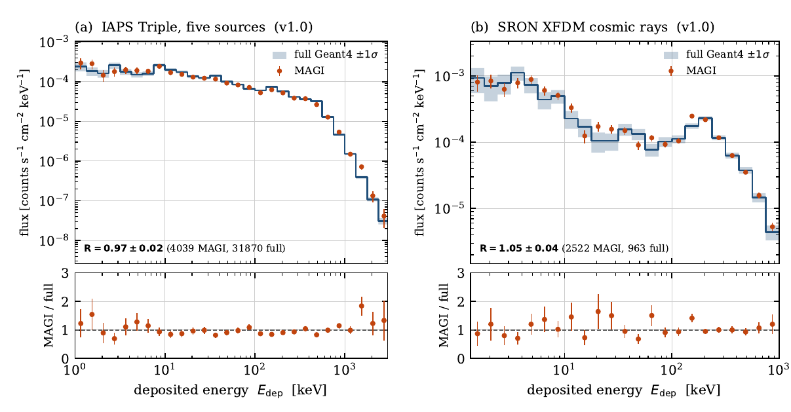

# MAGI

**M**ultivariate **A**utoencoder for particle **G**enerative **I**nference

[](LICENSE)
[](MAGI_package/setup.py)
[](https://doi.org/10.5281/zenodo.24119082)

A Conditional Variational Autoencoder (CVAE) that learns the joint phase-space
distribution of particles crossing a surface in a Geant4 Monte Carlo simulation,
that is energy, position, direction and particle type, and samples new, physically
consistent events at a fraction of the cost of rerunning the full transport.

It is intended as a drop-in particle source: cut a long simulation at a surface,
pay for the expensive outer transport once, and resample from the learned
distribution instead of rerunning it. That pays off whenever the events reaching
that surface are rare for physical or geometrical reasons: a rarely-triggering
detector, a source buried deep in shielding, a spectral line with poor
statistics. The energy head models the spectrum as a gated mixture of a
normalizing-flow continuum and fixed-position line components pinned at measured
atomic transition energies, with a learned conditional prior that preserves
energy-geometry correlations through generation.

Built on `keras`/`tensorflow`. Author: Francesco Monastra
([ORCID](https://orcid.org/0009-0007-1675-6223)), Istituto Nazionale di
Astrofisica - Istituto di Astrofisica e Planetologia Spaziali (INAF-IAPS),
Osservatorio Astronomico di Roma (INAF-OAR), Agenzia Spaziale Italiana - Space
Science Data Center (ASI-SSDC), Università degli Studi di Roma "Tor Vergata".

## State of the project

MAGI is at **v1.0.0**. The architecture is a gated mixture energy head over a
normalizing-flow continuum and pinned emission lines, with a learned conditional
prior (`CVAE_MixEnergy_ContPhi_TaskAdaptive`; see
[`Versions Guideline.md`](Versions%20Guideline.md) for the version lineage). It has
been validated end to end, with data in and detector counts out, on two independent
cryogenic-detector mass models: **IAPS Triple** (five sources: $^{232}$Th,
$^{226}$Ra, $^{40}$K, $\gamma$ and $\mu$) and the **SRON XFDM** TES-array
cryostat (cosmic rays). The five IAPS Triple models ship in this repository
([`trained_models/`](trained_models/)), so you can generate from them immediately,
alongside the full pipeline to train on your own source and geometry.

## What is new in v1.0.0

v0.8.2 was a beta. Its open points were the deficit of the SRON cosmic-ray closure
(R = 0.846 ± 0.088), the unstable line intensities and the repeated entries of one
track on the crossing surface. v1.0.0 changes the following (the full list is in
[`CHANGELOG.md`](CHANGELOG.md)).

- **Prior refit.** The prior is refitted on the frozen encoder as the last training
  stage (`magi.refit_prior`). About 80 % of the excess classifier AUC of the original
  model came from the prior, and the refit removes most of it.
- **Line fixes.** Fixed-position line components in the mixture head, a line-free
  quantile warp for the continuum, and a pinned uncollided-primary component in the
  primary-conditioned models. The 511 keV line of the cosmic-ray model is 3.40 % of
  the generated $\gamma$ against 3.45 % real.
- **Primary-conditioned models and grouped generation**, so that the crossings of one
  primary are generated together.
- **Virtual tracking ball and first-entry rule.** The old thin Geant4 shell is
  replaced by a virtual sphere, and only the first entry of a track is used for
  training and re-injection ([`Geant4_src/`](Geant4_src/), `MULTIVERSE.md`). The
  ball counts 0.00485 crossings per primary against 0.00484 for the shell, with
  none of 4838 shell crossings missing.
- **Geant4 injector** reading a text or binary (GNTBIN) file produced by
  `scripts/generate_geant_source.py`.
- **Resumable training, circuit visualisers** (`save_routing_circuit`,
  `save_full_circuit`) and 238 unit tests.

## Why this is validated the way it is

Reproducing marginal distributions is a minimum requirement for a generative
model. The claim of this repository is stronger: the generated crossings are
re-injected into the same Geant4 mass model, and the resulting **detector-level
spectrum and rate** are compared against a full, independent simulation. With
$N_{\rm events}$ detector events from $N_{\rm crossings}$ injected crossings in both
arms,

R = (N_events / N_crossings)_MAGI / (N_events / N_crossings)_full

and R = 1 means that a MAGI crossing yields events at the real rate.

<p align="center">
  
</p>

Detector response of MAGI against full Geant4 in the same mass model, with ±1σ
Poisson bands and MAGI-to-full ratios in the bottom panels. (a) IAPS Triple, five
sources. (b) SRON XFDM cosmic rays, against 2.4 × 10⁶ re-injected real crossings.

| Mass model | Sources | R |
|---|---|---|
| IAPS Triple | $^{232}$Th, $^{226}$Ra, $^{40}$K, $\gamma$, $\mu$ (5x statistics, pooled) | 0.97 ± 0.02 |
| SRON XFDM | cosmic rays, 1 keV to 1 MeV (6.0 × 10⁶ crossings per arm) | 1.05 ± 0.04 |

The real arm of IAPS Triple is 2.7 × 10⁹ to 5.4 × 10¹⁰ primaries per source on a
cluster, and the MAGI arm is 8 × 10⁵ to 4 × 10⁶ crossings per source on a laptop
(Apple M1). The validation uses Geant4 10.4.3, and the training and validation
datasets are independent at detector level.

### Amplification and speed-up

The statistical amplification is 1/χ, the detector events gained per generated
crossing instead of per thrown primary. The speed-up S compares the computational
cost: a crossing starts inside the assembly and costs more to transport than a
primary, so S = (1/χ) (c_primary / c_crossing). S leaves out the outer campaign that
records the training set and the training time, and it is the limit for a large
target. Measured on a laptop with v1.0.0:

| | SRON Th | SRON Ra | SRON K-40 | SRON CR | IAPS Th | IAPS Ra | IAPS K-40 | IAPS γ | IAPS μ |
|---|---|---|---|---|---|---|---|---|---|
| 1/χ | 464 | 601 | 6542 | 144.5 | 668 | 869 | 12175 | 276 | 153 |
| S | 142 | 130 | 247 | 2.1 | 50 | 61 | 122 | 10.8 | 4.1 |
| S_net, A = 10³ | 119 | 110 | 190 | 2.1 | 47 | 57 | 108 | 10.6 | 4.1 |

A is the target in units of the primaries behind the training set. Generating 10⁶
crossings takes 46 s on one thread, and training takes 10 to 24 core-hours.
Rare, heavily attenuated sources gain most (K-40, S = 122 to 247), while the
penetrating sources gain least (γ, μ and cosmic rays, S = 2.1 to 10.8).

The numbers of this section are those of the proceedings paper (arXiv link to be
added). The manual gives the full validation record, including the open points below.

## Current limitations

- **The crossing surface is a sphere.** Other surfaces need a rework of the
  geometry transforms in `preprocessing.py` and `generation/reconstruction.py`. A
  dummy spherical tracking volume around the region of interest is the usual
  workaround.
- **Crossings are independent given the conditioning.** The correlations inside one
  shower are not represented, and the energies of the crossings of one primary can
  sum to more than its energy. The follow-up autoregressive model (MAGIv2, released
  separately) addresses this.
- **The prior does not match the aggregated posterior exactly.** The classifier AUC
  of the cosmic-ray model is 0.62 to 0.63 after the refit against 0.50 for two real
  subsets, and the per-bin RMS of the marginals is four to five times the counting
  noise on every source.
- **Th and Ra closures are the weakest.** R is 0.88 (Th) and 0.86 (Ra) on IAPS
  Triple, and 1.40 ± 0.22 and 1.31 ± 0.19 on SRON, which disagree in sign. A
  detector rate from a Th or Ra source has to be quoted with these deviations.
- **Grazing entries.** About 5 % of the Th and Ra points have an outward direction at
  the surface.
- **Line intensities are source-dependent.** Line positions are pinned and audited to
  0.5 eV or better, but the intensity of a rare line must be measured on the source
  (`tools/acceptance_v0_8.py`) before it is quoted.
- **Not covered:** sources in passive material and the Athena mass model. The open
  closures (Th and Ra tails, K-40, two more seeds) are planned for v1.0.1.

## Install

```bash
pip install -r requirements.txt
```

which installs `magi` in editable mode from `MAGI_package/`. To develop the
package itself directly:

```bash
pip install -e MAGI_package/
```

Core runtime deps: `tensorflow>=2.16`, `tensorflow_probability[tf]>=0.24`,
`numpy`, `scipy`, `pandas`, `scikit-learn`, `astropy`, `joblib`, `h5py`,
`seaborn`, `optuna`. Test suite: `pytest MAGI_package/tests/` (238 tests).

Training defaults to CPU (`cpu_only=True`): on Apple Silicon, Metal was measured
slower than CPU for this workload.

## Quickstart

**[`MAGI_v1_0_IAPS_Triple.ipynb`](MAGI_v1_0_IAPS_Triple.ipynb)** loads the five
trained IAPS Triple models, generates the crossings of each source on the tracking
ball, checks that every point lies on the sphere and every direction is a unit
vector, and plots the spectra. It needs no training data.

**[`Example_Usage.ipynb`](Example_Usage.ipynb)** is a runnable, fully-commented
walkthrough of the whole pipeline (load, preprocess, detect spectral lines, build
dataset, train, checkpoint, reload, generate, validate, export a Geant4 source
file) on a synthetic source, so it needs no data download and trains in minutes
on CPU.

## Repo layout

- **[`MAGI_package/`](MAGI_package/)**: the installable library (`import magi`).
  See [`MAGI_package/README.md`](MAGI_package/README.md) for install details and
  [`MAGI_package/docs/USAGE.md`](MAGI_package/docs/USAGE.md) for the full usage
  guide, including the current limitations.
- **[`Example_Usage.ipynb`](Example_Usage.ipynb)** and
  **[`MAGI_v1_0_IAPS_Triple.ipynb`](MAGI_v1_0_IAPS_Triple.ipynb)**: the two notebooks above.
- **[`trained_models/`](trained_models/)**: the five IAPS Triple models (`IAPS_K40`,
  `IAPS_Ra226`, `IAPS_Th232`, `IAPS_gamma`, `IAPS_mu`). Each folder is one unit
  (`*.weights.h5`, `*_config.json`, `*_metadata.json`, `*_task_weights.json`,
  `*_history.json`, `*_summary.txt`, `*_quantile_transformers.joblib`) and has to be
  kept together.
- **[`scripts/generate_geant_source.py`](scripts/generate_geant_source.py)**:
  generates a Geant4-ready particle source file from a trained model outside a
  notebook; the Geant4 injector calls it for on-demand generation.
- **[`Geant4_src/`](Geant4_src/)**: the Geant4 side, namely the MultiVerse tracking
  ball with the first-entry rule and the injector that reads a MAGI file. See its
  README for the macro commands and the changes needed in your own application.
- **[`tools/`](tools/)**: scripts around a training run: the trainers, the
  acceptance harness (`acceptance_v0_8.py`), the AUC and per-bin RMS scorers, the
  line-centroid audit, the memorisation test, the candidate-line builder
  (`build_candidate_lines_from_geant4.py`), a detached runner for long jobs, and
  the synthetic stress tests.
- **[`CandidateLines/`](CandidateLines/)**: example candidate-line tables, the
  format `magi.load_candidate_energy_lines` reads.
- **[`docs/manual/magi_manual.pdf`](docs/manual/magi_manual.pdf)**: the user
  manual with code structure, API and settings, tools, a worked full run, a worked
  validation, the theoretical foundation, the measured accuracy and the limits.
- **[`CHANGELOG.md`](CHANGELOG.md)**: what v1.0.0 changes with respect to v0.8.2.
- **[`Versions Guideline.md`](Versions%20Guideline.md)**: the model-variant naming
  history.

## Citing MAGI

See [`CITATION.cff`](CITATION.cff) (GitHub's "Cite this repository" button reads
this directly), or cite the archived release, v1.0.0, through its DOI
[10.5281/zenodo.24119082](https://doi.org/10.5281/zenodo.24119082). The
proceedings paper will be linked here once it is on arXiv.

## License

[GPL-3.0-only](LICENSE), the same license used by
[KDSource](https://github.com/KDSource/KDSource), a sibling tool for Monte
Carlo particle source modeling via kernel density estimation.
